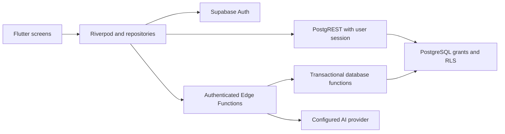

# GymLevel architecture

Updated: 2026-10-26. Execution evidence is maintained in [IMPLEMENTATION_STATUS.md](IMPLEMENTATION_STATUS.md).

## Runtime and data flow

`app/lib/main.dart` initializes the client and application providers. GoRouter controls authentication, onboarding, and the navigation shell. Domain models use Freezed/JSON generation. The existing localization engine manages Vietnamese/English labels and a persisted preference.

Supabase is the sole authoritative backend. No Firebase runtime dependency or alternate backend exists. No separate FastAPI deployment is required. Supabase Storage is available for future uploads; there is no implemented avatar upload flow today.

## Data ownership

| Data | Tables | Authority |
|---|---|---|
| Identity and progression | `auth.users`, `public.users` | Auth identity; server-managed progression |
| Profile and preferences | `profiles` | Validated owner profile writes |
| Exercise catalog | `exercises` | Server-managed catalog; client reads |
| Workout history | `workouts`, `workout_exercises`, `workout_sets` | Owner logging; server completion/rewards |
| Reward ledger | `xp_logs` | Server writes; owner reads |
| Idempotent completion | `workout_rewards` | Original committed response per workout; server writes |
| Classes | `user_classes`, `class_definitions`, `class_synergies` | Server progression and validated switching |
| Daily objectives | `quests`, `quest_instances` | Server generation, eligibility, completion |
| Streaks and records | `streaks`, `exercise_prs` | Derived from validated activity |
| Achievements | `user_achievements` | Unique server-issued unlocks |
| Coach quota | `coach_daily_usage` | Atomic server-enforced daily counter |

Client-provided XP, level, ownership, reward eligibility, and completion flags are untrusted. Workout previews are estimates. Committed backend responses drive final feedback. Retrying a reward operation must return its existing result.

The migration directory is the schema source of truth. Do not execute legacy setup snippets against an existing project or maintain a parallel schema definition. Remote adoption requires comparing the target's schema and migration history.

Current migrations are `20261026000100_baseline.sql` and `20261026000200_authoritative_progression.sql`. The baseline consolidates existing tables; the second restricts grants/policies and adds authority, lifecycle, quota and reward operations. `seed.sql` adds missing catalog/template entries without truncating user-linked data.

Authenticated RPC contracts: `initialize_user(p_profile)`, `start_workout()`, `begin_workout(p_workout_id)`, `set_workout_paused(p_workout_id, p_paused)`, `cancel_workout(p_workout_id)`, `complete_workout(p_workout_id, p_notes)`, `sync_daily_data()`, `switch_class(p_new_class_id, p_slot)`, `get_user_stats()`, and `consume_coach_request()`. Identity is derived from `auth.uid()`; clients do not submit an authoritative owner ID. Public/anonymous execution is revoked for protected operations.

## Security boundaries

Table grants and RLS work together. An ownership policy alone does not restrict which columns an owner may change. Protect progression columns and ledger writes with restricted server operations. [Supabase RLS reference](https://supabase.com/docs/guides/database/postgres/row-level-security).

User functions receive the access token in `Authorization: Bearer <user-jwt>` and the client key in `apikey`. The handler verifies identity and ownership; its privileged client remains server-side. Keep platform JWT verification enabled. [Function authentication](https://supabase.com/docs/guides/functions/auth), [authorization headers](https://supabase.com/docs/guides/functions/auth-headers).

Secrets belong in ignored server environment files or hosted function secrets. Do not log bearer tokens, provider keys, private profile content, or internal traces in client errors. AI may use bounded owner context but must not turn generated advice into verified workout records or progression.

## Design references

`CLASS_SYSTEM_SPEC.md`, `Classify_Gym_System.md`, `level_system.md`, and `user_profiling.md` preserve design history. [PROGRESSION_GUIDE.md](PROGRESSION_GUIDE.md) identifies implemented behavior. Draft concepts such as breakthrough challenges, level decay, hidden quests, and automatic AI actions are not evidence of shipped features.

`docs/admin/` is a future proposal. No Next.js app, admin provisioning, admin API, or admin schema is implemented. Any future admin browser must use a publishable key and authenticated session; privileged operations require server-side audited permission checks.
