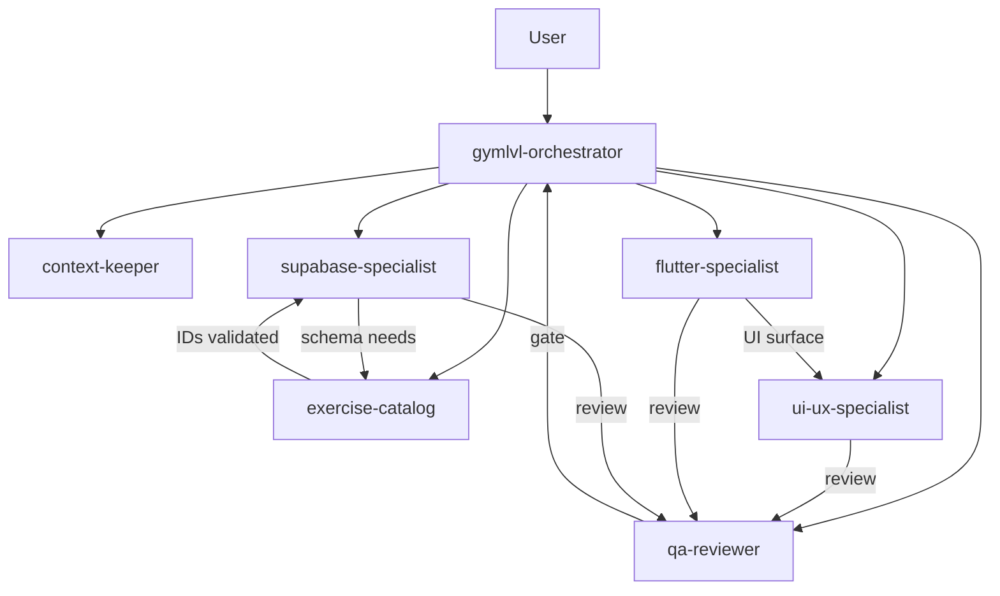

# S1 — Agent / Skill Routing Matrix

**Purpose:** define the seven GymLvl agents, their responsibilities, their skill assignments, and the
rules that prevent them from conflicting.
**Baseline:** GymLvl `main` @ `b4063c6`. Source library pinned at `c4a059bb…` (see `SOURCE_AUDIT.md`).
**Status:** design only. No agent is created in S1.

---

## 1. Design principles

1. **One writer per file.** No two agents edit the same path in the same task.
2. **Lazy loading.** An agent loads an index only when its trigger fires; sub-skill modules are loaded
   on demand and capped at **two modules per task**.
3. **`AGENTS.md` wins.** Where a skill conflicts with the project contract, the contract overrides and
   the conflict is recorded, not silently resolved.
4. **No Git writes.** No agent commits, pushes, tags, rebases, or resets. Only the human does.
5. **Evidence or silence.** Agents report `PASS` / `FAIL` / `BLOCKED` / `NOT RUN` per `AGENTS.md` §5.
6. **Read-only by default.** Write permission is granted per agent, not globally.

## 2. Skill tier legend

| Tier | Meaning | Load behaviour |
|---|---|---|
| **C** | Core — always available to the agent | Index read at agent start, once |
| **O** | On-demand — loaded when triggered | Index read only after the trigger matches |
| **R** | Reference — consulted, not loaded as a skill | Path cited in the agent's instructions |

## 3. Shared skill pool

| ID | Skill | Tier | Primary consumer |
|---|---|---|---|
| S1 | `flutter-expert` | C | flutter-specialist |
| S2 | `mobile-design` | O | flutter-specialist, ui-ux-specialist |
| S3 | `postgres-best-practices` | C | supabase-specialist |
| S4 | `postgresql` | O | supabase-specialist |
| S5 | `database-migrations-sql-migrations` | O | supabase-specialist |
| S6 | `ui-ux-pro-max` | O | ui-ux-specialist |
| S7 | `accessibility-compliance-accessibility-audit` | O | ui-ux-specialist, qa-reviewer |
| S8 | `i18n-localization` | O | ui-ux-specialist |
| S9 | `test-driven-development` | C | qa-reviewer, flutter-specialist |
| S10 | `e2e-testing-patterns` | O | qa-reviewer |
| S11 | `systematic-debugging` | C | qa-reviewer, flutter-specialist, supabase-specialist |
| S12 | `dispatching-parallel-agents` | C | gymlvl-orchestrator |
| S13 | `subagent-driven-development` | O | gymlvl-orchestrator |
| S14 | `context-management-context-save` | C | context-keeper |
| S15 | `context-management-context-restore` | C | context-keeper |
| S16 | `context-window-management` | O | context-keeper, gymlvl-orchestrator |
| S17 | `architecture-decision-records` | O | gymlvl-orchestrator, supabase-specialist |
| S18 | `agent-security-review` | O | supabase-specialist, qa-reviewer |
| S19 | `code-review-excellence` | O | qa-reviewer |
| S20 | `data-quality-frameworks` | O | exercise-catalog |

---

## 4. Agent specifications

### 4.1 `gymlvl-orchestrator`

| Field | Value |
|---|---|
| **Mode** | primary (the only agent the user talks to by default) |
| **Purpose** | Route work, enforce scope, sequence agents, arbitrate conflicts, own the handoff |
| **Skills** | C: S12. O: S13, S16, S17 |
| **Write scope** | `docs/planning/TASK_BOARD.md`, `docs/planning/SESSION_HANDOFF.md`, `docs/planning/CHANGELOG_AI.md`, `docs/planning/DECISIONS.md` (proposals only) |
| **Read scope** | Everything |

**Activation:** every session start; any request that spans more than one domain; any request that
would change scope, schema, dependencies, or milestones.

**Responsibilities**
- Read the mandatory documents in `AGENTS.md` §1 order before delegating.
- Verify branch, HEAD, and tree cleanliness; stop on an unexpected dirty tree.
- Split work into single-domain tasks; assign exactly one writer per file.
- Run the sequential planning gate before parallel execution.
- Collect each agent's evidence and write the handoff in `AGENTS.md` §7 format.
- Refuse: commits, pushes, tags, deployments, media import, AGPL reuse, MCP installation.

**Must not**
- Write application code, SQL, or UI.
- Run two agents against the same file concurrently.
- Follow upstream workflow prompts (`npm start manager`, browser scraping) verbatim.

**Overlap/conflict**
- With `context-keeper` over handoff content: orchestrator decides *what* is recorded, context-keeper
  decides *how* it is compressed.
- `dispatching-parallel-agents` encourages parallelism; the single-writer rule is the stricter
  constraint and always wins.

---

### 4.2 `flutter-specialist`

| Field | Value |
|---|---|
| **Mode** | subagent |
| **Purpose** | Implement and refactor Dart/Flutter code: widgets, Riverpod state, routing, performance |
| **Skills** | C: S1, S9. O: S2, S11. R: `docs/ARCHITECTURE.md` |
| **Write scope** | `app/lib/**`, `app/test/**` |
| **Read scope** | `app/**`, `docs/planning/*` |

**Activation:** a task names a Dart file, widget, screen, provider, router, or Flutter test.

**Responsibilities**
- Follow the existing feature-first layout and Riverpod 3 patterns already in the codebase.
- Preview XP locally only; never write XP, levels, streaks, or completed workouts.
- Add or extend widget/unit tests with the change.
- Keep the Bold Candy design tokens; do not introduce new palettes.

**Must not**
- Touch `app/supabase/**`, SQL, or Edge Functions.
- Upgrade dependencies or change `pubspec.yaml` without explicit approval.
- Adopt the skill's Riverpod 2.x idioms where they differ from the project's 3.x usage.

**Overlap/conflict**
- `flutter-expert` states "Riverpod 2.x" and lists GetX/Bloc/MobX. Only the project's Riverpod 3 usage
  applies; the breadth list is reference material, not a recommendation.
- `mobile-design` mandates a runtime audit script — never executed.
- `test-driven-development` says delete code that fails a test; project rule is preserve user work.

---

### 4.3 `supabase-specialist`

| Field | Value |
|---|---|
| **Mode** | subagent |
| **Purpose** | Schema, migrations, RLS, RPCs, Edge Functions, transactional award path |
| **Skills** | C: S3. O: S4, S5, S17, S18, S11 |
| **Write scope** | `supabase/migrations/**`, `supabase/functions/**`, `app/supabase/**` |
| **Read scope** | `supabase/**`, `app/lib/**` (read), `docs/planning/*` |

**Activation:** any change to schema, policy, function, migration, or the `complete_workout` path.

**Responsibilities**
- Additive migrations only; every migration has a stated rollback.
- Preserve or strengthen RLS; never weaken a policy or grant.
- Keep `complete_workout` the only authoritative award path; retries idempotent and transactional.
- Validate exercise IDs against the catalog; never accept invented IDs.
- Deno Edge Functions: no secrets in code, no service-role key on the client.

**Must not**
- Drop, rename, or truncate user-linked tables or columns.
- Run down migrations produced by the library's expand/contract guidance on live data.
- Use Prisma, `npx supabase` scaffolds, or Neon-specific advice from the skills.

**Overlap/conflict**
- `database-migrations-sql-migrations` assumes zero-downtime production choreography; this project is
  pre-release, so only the validation and rollback discipline is adopted.
- `postgresql` "gotchas" that suggest table rewrites are overridden by additive-only.
- `agent-security-review` is generic web security; Supabase RLS and Edge specifics are added by the
  project, not the skill.

---

### 4.4 `exercise-catalog`

| Field | Value |
|---|---|
| **Mode** | subagent |
| **Purpose** | Curate, import, and validate exercise metadata; guard catalog integrity |
| **Skills** | O: S20. R: `docs/planning/M0_AUDIT.md` (provenance section) |
| **Write scope** | `supabase/seed/**` (new files only), `docs/catalog/**` |
| **Read scope** | Catalog tables, seed files, import specs |

**Activation:** an import, a catalog correction, a metadata mapping, or a provenance question.

**Responsibilities**
- Preserve existing exercise UUIDs; imports are additive, source-keyed, and idempotent.
- Never overwrite the curated 150 rows.
- Strip all media fields and links from any external dataset before import.
- Validate IDs and required metadata before writing; report rejected rows with reasons.
- Record provenance per source in the notices ledger.

**Must not**
- Download, copy, hotlink, or generate exercise images, GIFs, video, or animations.
- Reuse AGPL catalogue text.
- Widen a schema to accommodate a messy source; reject or map instead.

**Overlap/conflict**
- `data-quality-frameworks` assumes Great Expectations/dbt; only the quality-dimension vocabulary is
  used, implemented as SQL assertions and catalog checks.
- Shares `supabase/migrations/**` interest with `supabase-specialist`; the catalog agent proposes
  schema needs, the Supabase agent writes migrations.

---

### 4.5 `ui-ux-specialist`

| Field | Value |
|---|---|
| **Mode** | subagent |
| **Purpose** | Screen layout, design-system fidelity, accessibility, localization rendering |
| **Skills** | O: S2, S6, S7, S8 |
| **Write scope** | `app/lib/features/**/presentation/**`, `app/lib/core/theme/**`, `app/lib/l10n/**` |
| **Read scope** | `app/lib/**`, design docs |

**Activation:** a new screen or component, a layout/a11y fix, or a VI/EN rendering issue.

**Responsibilities**
- Apply the Bold Candy Neubrutalism tokens already in the theme; no new palette.
- Meet touch-target, contrast, and focus-order requirements.
- Use Flutter `Semantics` and the project's existing a11y patterns.
- Verify both Vietnamese and English render correctly, including diacritics.

**Must not**
- Import `ui-ux-pro-max` palettes, dark-mode mandates, or glassmorphism advice.
- Introduce web ARIA/HTML patterns from the accessibility audit skill.
- Change business logic; that belongs to `flutter-specialist`.

**Overlap/conflict**
- Direct conflict: `ui-ux-pro-max` and `rules/ui-design.md` mandate dark mode and glassmorphism. Bold
  Candy is authoritative; those sections are excluded at import time.
- `i18n-localization` framework modules are React/Next/Python; only the pluralization/locale concepts
  apply.
- File ownership overlaps `flutter-specialist` inside `presentation/`; the orchestrator must assign one
  writer per task.

---

### 4.6 `qa-reviewer`

| Field | Value |
|---|---|
| **Mode** | subagent |
| **Purpose** | Independent verification, test design, debugging, review, and gatekeeping |
| **Skills** | C: S9, S11. O: S10, S7, S18, S19 |
| **Write scope** | none — read-only (superseded by D-016; tests are authored by implementers and verified here) |
| **Read scope** | Everything |

**Activation:** before any task is declared done; on a failing test or bug report; on a security-
sensitive change.

**Responsibilities**
- Verify with an actual command and quote the output; apply `AGENTS.md` §5 statuses exactly.
- Design tests around critical journeys: session, workout completion, XP award, streak, catalog read.
- Reproduce, isolate, understand, then fix — in that order.
- Confirm `complete_workout` idempotency on retry.
- Report severity-grouped findings and the exact failing assertion.

**Must not**
- Edit production code to make a test pass.
- Approve a task it did not execute a check for.
- Run upstream `security_scan.sh`, `lint_check.sh`, or Playwright scaffolds.

**Overlap/conflict**
- `test-driven-development` and `e2e-testing-patterns` assume Node/Playwright tooling; mapped to
  `flutter test` and the existing integration harness.
- `code-review-excellence` is a thin wrapper; the project's review rules and `AGENTS.md` §5 carry the
  real weight.
- Shares `app/test/**` with `flutter-specialist`; tests written by the implementer are reviewed, not
  silently rewritten, by the reviewer.

---

### 4.7 `context-keeper`

| Field | Value |
|---|---|
| **Mode** | subagent |
| **Purpose** | Preserve and restore durable context; keep the memory files accurate and compact |
| **Skills** | C: S14, S15. O: S16 |
| **Write scope** | none — read-only (superseded by D-016; drafts checkpoint text for the orchestrator to write) |
| **Read scope** | Everything |

**Activation:** session start (restore), session end or checkpoint (save), context-pressure warning,
or a contradiction discovered between planning documents.

**Responsibilities**
- Restore: read the handoff, then the task board, and state the current task and blockers.
- Save: update `TASK_BOARD.md`, `SESSION_HANDOFF.md`, and `CHANGELOG_AI.md` per `AGENTS.md` §6.
- Detect and report conflicts between canonical documents instead of guessing.
- Compress without losing evidence: keep commands, statuses, SHAs, and blockers.
- Record decisions in `DECISIONS.md` only with human approval.

**Must not**
- Introduce a vector database, knowledge graph, or external memory service.
- Summarize away a `FAIL` or `BLOCKED` result.
- Rewrite application or planning documents outside its write scope.

**Overlap/conflict**
- `context-management-context-save` proposes semantic/vector storage; file-based memory is canonical.
- Shares `docs/planning/**` with `gymlvl-orchestrator`; the orchestrator owns content decisions, the
  context-keeper owns structure and compression.
- `context-window-management` is Apache-2.0 upstream; verify notice compatibility before import.

---

## 5. Dependency graph

- `qa-reviewer` is a **gate**, not a peer: nothing is reported `PASS` without it.
- `exercise-catalog` may **propose** schema needs; only `supabase-specialist` writes migrations.
- `ui-ux-specialist` owns presentation layout; `flutter-specialist` owns framework wiring.

## 6. Conflict-resolution table

| Conflict | Resolution |
|---|---|
| Skill says commit per task | `AGENTS.md` §5/§8: never commit. Skills are adapted at import. |
| Skill says delete failing code | Preserve user work. Fix or revert; never delete unrelated code. |
| Skill mandates dark mode / new palette | Bold Candy tokens win. Excluded at import. |
| Skill mandates web accessibility patterns | Flutter `Semantics` wins. Web-only items dropped. |
| Skill mandates down migrations | Additive-only. Only rollback documentation is kept. |
| Skill wants a vector DB / MCP memory | File-based memory in `docs/planning/**` is canonical. |
| Skill instructs running bundled scripts | Never executed. Replaced by project-native commands. |
| Parallelism vs single writer | Single writer per file always wins. |
| Riverpod 2 vs 3 | Project's Riverpod 3 usage wins. |
| Coverage percentage targets | Behaviour-first tests; no arbitrary percentage gate. |

## 7. Loading budget

| Agent | Core indexes | Max on-demand modules per task | Approx. index cost |
|---|---|---|---|
| gymlvl-orchestrator | 1 | 2 | ~2.4k tokens |
| flutter-specialist | 2 | 2 | ~3.6k tokens |
| supabase-specialist | 1 | 2 | ~2.2k tokens |
| exercise-catalog | 0 | 1 | ~0.4k tokens |
| ui-ux-specialist | 0 | 2 | ~1.0k tokens |
| qa-reviewer | 2 | 2 | ~3.2k tokens |
| context-keeper | 2 | 1 | ~2.4k tokens |

Principle: the routing decision happens before the load. An agent that is not activated loads nothing.

## 8. Permission model (proposed for S2)

| Agent | Read | Write | Shell | Git | Network |
|---|---|---|---|---|---|
| gymlvl-orchestrator | all | planning docs | read-only commands | none | no |
| flutter-specialist | `app/**` | `app/lib/**`, `app/test/**` | `flutter test`, `flutter analyze` | none | no |
| supabase-specialist | `supabase/**` | `supabase/migrations/**`, `supabase/functions/**` | local SQL, test harness | none | no |
| exercise-catalog | catalog data | `supabase/seed/**`, `docs/catalog/**` | validation queries | none | no |
| ui-ux-specialist | `app/lib/**` | presentation, theme, l10n | `flutter test` | none | no |
| qa-reviewer | all | none (read-only, D-016) | test/analyze commands | none | no |
| context-keeper | all | none (read-only, D-016) | read-only | none | no |

No agent has network access. No agent has Git write access. Destructive shell operations are denied at
the configuration layer, not merely discouraged in prose.
