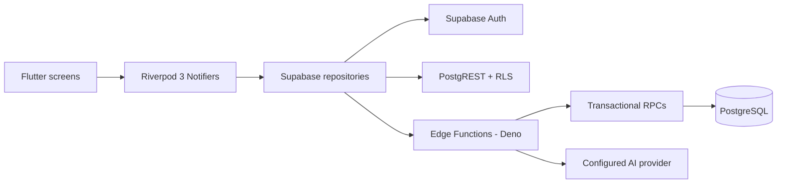
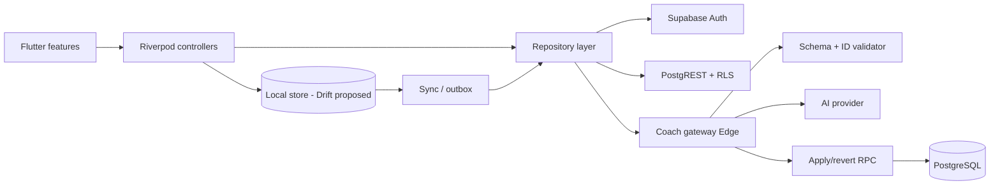

# GymLvl — Architecture (Planning Memory)

**Status:** Durable planning record
**Last verified:** 2026-10-28 at `56c1122`
**Related:** [`docs/ARCHITECTURE.md`](../ARCHITECTURE.md) (existing runtime documentation),
[`PROJECT_CONTEXT.md`](PROJECT_CONTEXT.md), [`DECISIONS.md`](DECISIONS.md)

> **Read this distinction first.** Sections 1–4 describe what exists **today**. Sections 5–8
> describe the **proposed target**. Proposed components are not implemented and require approval.
> Nothing in this file authorizes a schema or code change.

---

## 1. Current runtime



- `app/lib/main.dart` initializes Supabase and the provider scope.
- `app/lib/core/router/app_router.dart` + `auth_redirect.dart` gate session, onboarding, and deep
  links.
- Freezed models for workouts, sets, exercises, stats, and profiles.
- The localization engine manages Vietnamese/English labels and a persisted preference.
- Supabase is the sole authoritative backend. No Firebase runtime dependency or alternate backend.
- Supabase Storage exists but no avatar/media upload flow is implemented.

## 2. Current module map

```text
app/lib/
  core/
    config/          # Supabase initialization and configuration guard
    localization/    # VI/EN labels and preference
    router/          # GoRouter, auth redirect, shell, active-workout banner
    theme/           # Candy tokens and ThemeData
  features/
    auth/            # session gate, login, register, reset
    onboarding/      # 9-step draft, class definitions A-F
    dashboard/       # RPG hero XP, KPI, activity, quests, volume
    workout/         # picker, active session, sets, rest timer, history
    progression/     # display-only XP estimate + class math
    quests/          # daily quests
    profile/         # preferences, class, locale
    coach/           # chat-only AI proxy client
  ui/
    candy/           # 16+ Candy Neubrutalism primitives
app/test/            # 126 tests, including responsive UI regression
```

## 3. Current data ownership

| Data | Tables | Authority |
|---|---|---|
| Identity | `auth.users`, `public.users` | Supabase Auth; server-managed progression fields |
| Profile | `profiles` | User-editable allowlisted columns |
| Catalog | `exercises` | Seeded; read-only to clients |
| Workout session | `workouts`, `workout_exercises`, `workout_sets` | User owns active session; completion is server-controlled |
| Rewards | `workout_rewards`, `xp_logs`, `streaks`, `quest_instances`, `exercise_prs`, `user_achievements` | PostgreSQL RPC only |
| RPG classes | `class_definitions`, `class_synergies`, `user_classes` | Seeded definitions; server-managed assignment/progress |
| Coach quota | `coach_daily_usage` | Server only |

There are **17 tables** in total.

## 4. Current invariants

These are load-bearing. Do not weaken them.

1. **Completion is server-authoritative.** `complete_workout` runs in one transaction, row-locks the
   workout and user, replays `workout_rewards` for idempotency, clamps suspicious pace, and writes
   XP/class XP/quest/streak state.
2. **One reward per workout.** Retrying completion must not double-award.
3. **Clients cannot write progression.** Direct updates to `total_xp`, levels, streaks, quests, PRs,
   or achievements are denied by grants/RLS. `ProgressionEngine` is display-only.
4. **RLS is default-deny for user data.** Users can read/write only their own rows where allowed.
   Exercise catalog is readable by authenticated users.
5. **Workout history is immutable after completion.** Only `notes` on an active workout is
   user-updatable at the row level.
6. **Exercise IDs are stable.** Existing 150 UUIDs must be preserved by any import.
7. **Time zone.** Store UTC. Compute streaks, quests and daily aggregates in the user's
   `profiles.timezone`, which defaults to `Asia/Ho_Chi_Minh`.
8. **Design system.** Candy tokens and primitives are the UI contract. Light mode is the product
   mode; the legacy dark theme must not become the default.
9. **Core training works without AI.** The coach is optional and cannot block logging.

## 5. Target architecture (proposed — not implemented)



### 5.1 Flutter module target

```text
app/lib/
  core/
    design_system/        # existing ui/candy, tokens, typography
    data/                 # repository interfaces, local db, sync
    config/ router/ localization/
  features/
    auth/
    onboarding/
    exercise_library/     # catalog, search, detail, aliases
    training_plan/        # plans, days, routines, scheduling
    workout/              # session, logging, timers, summary
    progression/          # pure Dart policies, 1RM, PR, deload
    analytics/            # heatmap, body map, weight, PR charts
    quests/ progression-rpg/ profile/
    coach/                # intake, proposals, review, consent
```

**Status:** proposed. Moving existing code is a refactor and requires its own approved task. Do not
rename or relocate existing modules as a side effect of a feature task.

### 5.2 Local-first storage (proposed: Drift)

- Mature SQLite, migrations, testable.
- Mobile-first; web/WASM is not a release requirement.
- Use `shared_preferences` only for lightweight settings.
- Proposed tables: `cached_exercises`, `cached_instructions`, `active_workout_draft`,
  `pending_mutations`, `sync_state`, `catalog_version`.
- Every mutation gets a client-generated idempotency key; replay must be safe.
- Server remains authoritative; the outbox is a delivery mechanism, not a second source of truth.

**Approval state:** proposed in M0, not approved. Do not add the dependency until `DECISIONS.md`
records approval.

### 5.3 Catalog schema (proposed, additive)

```text
exercise_catalog
  id uuid pk                 -- legacy exercises.id preserved
  source text                -- 'gymlvl' | 'exercisedb'
  external_id text           -- dataset four-digit id
  slug text unique
  name_en text, name_vi text
  body_part text, equipment text, target text, secondary_muscles text[]
  category text, movement_pattern text, difficulty text
  instructions jsonb         -- { en: [...], vi: [...] }
  content_version int, active bool
  provenance jsonb           -- source URL, SHA, license, reviewer
  UNIQUE(source, external_id)

exercise_source_map(legacy_exercise_id, source, external_id, confidence)
exercise_media(exercise_id, kind, object_key, rights_status default 'unavailable',
               license_reference, attribution, checksum)
```

Rules:

- Do not overwrite the 150 curated rows or change their UUIDs.
- New records get new rows; merge display duplicates later.
- Import text/metadata only. Strip `image`, `gif_url`, `media_id`, `attribution` media claims.
- `exercise_media` defaults to `unavailable`; no media UI until rights exist.

### 5.4 Training domain (proposed, additive)

```text
training_plans(id, user_id, name, goal, class_id, version, status, created_at)
plan_days(id, plan_id, weekday, routine_id, order)
plan_routines(id, plan_id, name, progression_policy, notes)
plan_exercises(id, routine_id, exercise_id, position, mode, sets,
               reps_min, reps_max, seconds, distance, target_weight,
               rest_seconds, superset_group, progression_policy)
```

Workout sets gain nullable additive columns:

```text
mode         -- 'reps' | 'time' | 'cardio'
set_type     -- 'workout' | 'warmup' | 'dropset' | 'restpause'
rpe, rir
per_side
distance_m, speed_kph, incline
failure
```

Existing rows remain valid because every new column is nullable or defaulted.

### 5.5 Coach schema (proposed)

```text
coach_profiles(user_id, goals, experience, days_per_week, session_minutes,
               equipment[], limitations, dislikes, version)
coach_consents(user_id, version, categories[], agreed_at, revoked_at)
coach_proposals(id, user_id, kind, plan_version, plan_hash,
                payload_json, status, created_at, expires_at)
coach_proposal_items(id, proposal_id, change_type, target, before, after,
                     rationale, status)
coach_audit_logs(id, user_id, action, proposal_id, summary, created_at)
```

Proposals are **inert**. Application is a transactional RPC that verifies ownership, plan version,
and plan hash, snapshots the previous plan, applies approved items, and audits. Revert affects the
plan only, never workout history.

## 6. AI Coach boundary (proposed)

| Layer | Owns |
|---|---|
| Edge gateway | Auth, consent, quota, payload allowlist, provider call, schema validation, proposal persistence, audit |
| AI model | Judgement: routines, exercise selection, rationale, review |
| Deterministic Dart engine | Load targets, progression, deload, 1RM, PR |
| User | Approves/rejects each change |
| Database RPC | Atomic apply/revert, version/hash/ownership checks |

Hard rules:

- No AI write access to `xp_logs`, `workouts`, `workout_sets`, `exercise_prs`, `users`, or
  `user_classes`.
- No invented exercise IDs; validate against the catalog.
- No load above actual history for a known exercise; unknown exercises start without weight.
- No medical diagnosis. Pain/red flags → conservative advice + recommend qualified care.
- Consent is recorded and revocable; withdrawal deletes server-side proposal data and stops egress.
- Payload allowlist: no name, email, user ID, token, or media. Pseudonymous handle only.
- Plan fingerprint prevents stale application.
- One repair round, then fail safely.
- Kill switch and per-intent quotas.
- Provider keys only in Supabase secrets.

## 7. Completion and rewards boundary

Keep and extend the existing design:

```text
client completes sets
  → finishWorkout(workoutId)
  → Edge/RPC complete_workout(workoutId, idempotency_key)
  → transaction: lock user + workout
  → validate completed sets / pace
  → replay guard via workout_rewards
  → write xp_logs, users.total_xp, user_classes, quests, streaks, PRs
  → commit
```

- This remains the **only** award path.
- AI, plans, imports, and analytics must never write rewards directly.
- Client previews are advisory and must be labelled as estimates.
- New workout modes must be validated server-side before they can earn XP.

## 8. Explicitly not implemented

Do not assume any of these exist:

- Drift or any local SQL database.
- Offline mutation queue or conflict resolution.
- Weekly plans, routines, scheduling, or rotations.
- Progression policies, deload, 1RM, RPE/RIR, PR display.
- Supersets, warm-up/drop/rest-pause set types, per-side work, plate math.
- Bodyweight trend, muscle map, heatmap, PR analytics.
- Typed AI proposals, consent records, apply/revert, audit.
- Exercise media pipeline.
- Android release CI build, iOS build, device smoke automation.
- Health/watch integrations.

## 9. Deployment and environments

- Local development: Flutter + local or remote Supabase configured via `--dart-define`.
- CI: `.github/workflows/verify.yml` runs SQL units, Edge checks/tests, Flutter analyze/test, and a
  web release build with placeholder Supabase values.
- **No Android APK build in CI today.**
- **No production deployment is authorized.**
- Migrations are applied manually or through the existing Supabase workflow; no automated
  production migration step exists in this repository.

## 10. Architecture change process

1. Write the proposal in `DECISIONS.md` with context, options, and consequences.
2. Get explicit approval.
3. Update this file and the original plan's index only after approval.
4. Implement in a scoped task with its own tests and rollback plan.
5. Record the result in `TASK_BOARD.md`, `SESSION_HANDOFF.md`, and `CHANGELOG_AI.md`.
